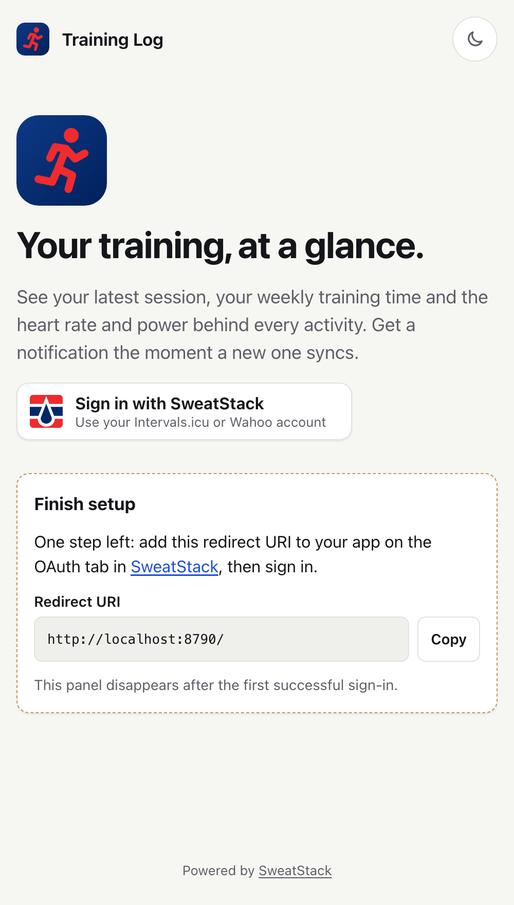
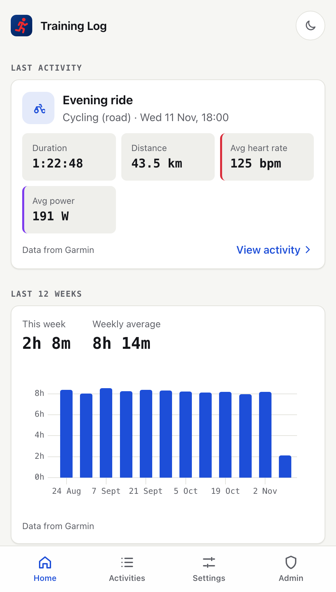
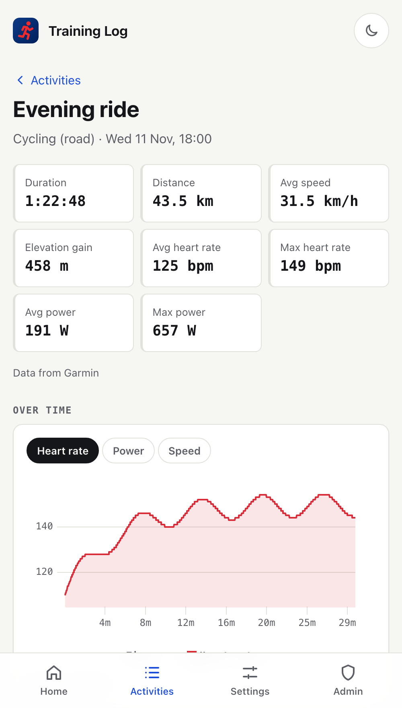

# SweatStack app template for Cloudflare

A small, complete app on [SweatStack](https://sweatstack.no) that you can deploy in minutes and then make your own:

- **Sign in with SweatStack.** Your users sign in with an account they already have (Intervals.icu, Wahoo and more).
- **Their training data.** The last activity, weekly training time, and every activity with all its metrics over time.
- **Analysis.** Time in each training zone (power, heart rate or pace) and the athlete's metabolic profile: threshold,
  critical power, VO2max, each with where it came from.
- **An installable app** (PWA) for iPhone and Android, with **push notifications** when a new activity arrives.
- **Runs on Cloudflare Workers**: one Worker and one D1 database. The free plan is enough to start.

It's built to be extended with a coding agent: server-rendered HTML, no client framework, no build step, small files and
one clear way to do each thing. [`AGENTS.md`](AGENTS.md) teaches your agent the patterns.

<p>
  
  
  
</p>

## Deploy

[](https://deploy.workers.cloudflare.com/?url=https://github.com/SweatStack/sweatstack-cloudflare-template)

1. **Create a SweatStack app** at [app.sweatstack.no/applications/new](https://app.sweatstack.no/applications/new). Tick
   *Activities: read*. You can leave the redirect URIs empty for now. On the app's **OAuth** tab, create a **client secret**
   and copy it (it's shown once).
2. **Click Deploy to Cloudflare** and paste the **Client ID** and **client secret** when asked. Everything else can stay
   empty. The button copies this repository to your GitHub account, creates the database and deploys.
3. **Open your app.** It shows the exact **redirect URI** to add to your SweatStack app (it's your app's address,
   `https://<your-app>.workers.dev/`).
4. **Sign in.** That's it. Your app's **Settings** page shows your SweatStack user id: add it as `ADMIN_USER_IDS` to get
   the **Admin** page, which walks you through notifications and going live.

Left something empty, or not sure what's missing? The app never crashes on missing configuration: it shows `/setup` with
the steps and the exact values for your deployment.

> **Your app starts private.** Only you can sign in until you fill in your app's *Consent screen* tab in SweatStack and
> [go live](https://docs.sweatstack.no/learn/applications/going-live/). The Admin page lists what it asks for, like your
> privacy policy URL.

## Configuration

All configuration is in **Worker secrets** (Cloudflare dashboard → your Worker → Settings → Variables and Secrets), so
it survives every redeploy. Any of them may be empty: the app tells you what's missing.

| Secret | What it is |
|---|---|
| `SWEATSTACK_CLIENT_ID` | Your SweatStack app's Client ID (OAuth tab). **Required.** |
| `SWEATSTACK_CLIENT_SECRET` | A client secret from the same tab. **Required.** |
| `ADMIN_USER_IDS` | Comma-separated SweatStack user ids that can open `/admin`. |
| `SWEATSTACK_WEBHOOK_SECRET` | The `whsec_…` secret from your app's **Webhooks** tab. Turns on new-activity notifications. |

The keys the app needs for itself (cookie signing, token encryption, push identity) are generated on first use and stored in
the database. You never have to make them up.

### Push notifications

1. On your SweatStack app's **Webhooks** tab, add `https://<your-app>/webhooks/sweatstack`.
2. Copy the signing secret into `SWEATSTACK_WEBHOOK_SECRET`.
3. In the app, open **Settings → Turn on notifications**. On iPhone, first add the app to your Home Screen (Share →
   *Add to Home Screen*) and open it from there: iOS only allows notifications for installed web apps.

When a connected user records an activity, SweatStack calls your webhook, and the app sends "Morning ride · 42.1 km ·
1:32:10" to their devices. The Admin page shows every webhook it received and what happened.

## Develop locally

Requires Node.js 20 or newer.

```sh
npm install
cp .dev.vars.example .dev.vars   # then fill in your credentials
npm run dev                      # http://localhost:8787
```

Use a **separate SweatStack app** for local development, with `http://localhost:8787/` as its redirect URI, so your live
app's settings stay tight.

| Command | |
|---|---|
| `npm run dev` | Run the app locally (applies database migrations first) |
| `npm test` | Tests, in the real Workers runtime |
| `npm run typecheck` | Regenerates `worker-configuration.d.ts` from `wrangler.jsonc`, then checks TypeScript |
| `npm run deploy` | Apply migrations to the production database and deploy |
| `npm run db:migrate` | Apply migrations to the local database |
| `npm run webhook:simulate` | Send a signed test webhook to your local app |

### Make it yours

- **Change the look**: `public/app.css` starts with ~20 design tokens (colours, radius, fonts). Open
  [`/design`](http://localhost:8787/design) for every component and every page, rendered from demo data, in light and dark.
- **Name it**: the app is called "Your App Name" until you change it in `src/app.config.ts` and
  `public/manifest.webmanifest`. Icons: `public/icons/` (`npm run icons`).
- **Your privacy policy and terms**: `content/privacy.md` and `content/terms.md` are placeholders. You're responsible
  for them as the app's operator.
- **New features**: see [`AGENTS.md`](AGENTS.md) for the recipes, or ask your coding agent, which reads it.

## How it works

```
Browser ──► Cloudflare Worker (Hono, server-rendered HTML + htmx) ──► SweatStack API
   ▲              │  D1: users + encrypted tokens, push subscriptions, webhook log
   │              ◄── SweatStack webhooks (new activity)
   └── Web Push ◄─┘
```

- **Sign-in** is OAuth 2.0 with your client secret. Tokens stay on the server (encrypted in D1). The browser only gets a
  signed session cookie with the user's id. Refresh tokens rotate; refreshes are serialized so concurrent requests never
  race (`src/auth/tokens.ts`).
- **Pages** are server-rendered with Hono JSX. htmx adds partial updates where they help (the activity chart loads
  lazily; the last activity refreshes when you return to the app). Everything else is plain links and forms.
- **Charts** are one web component, `<training-chart>`, drawing with uPlot. Timeseries come from SweatStack as Parquet,
  decoded on the server (`src/sweatstack/parquet.ts`). Activity charts and time in zone use SweatStack's
  [AISC segments](https://docs.sweatstack.no/learn/data/activities/#activity-data): 20-50x smaller than per-second data,
  drawn as steps (each segment's mean, held for its duration).
- **Notifications**: SweatStack webhook → signature check → Web Push to the user's devices, all with Web Crypto
  (`src/webhooks/`, `src/push/`).
- **Security**: strict Content-Security-Policy (no inline scripts), CSRF origin checks, httpOnly + SameSite cookies,
  OAuth `state`, verified webhooks, and pages never cached.

## Troubleshooting

- **"Sign-in didn't work: access wasn't granted"**: the app is private, so only its owner can sign in. Sign in with the
  SweatStack account that created the app, or go live.
- **SweatStack says the redirect URI is invalid**: add your app's address (`https://<your-app>/`) on the OAuth tab. Use
  *Test a redirect URI* there to check.
- **"This app isn't set up correctly"**: the client secret was rejected. Create a new one and update
  `SWEATSTACK_CLIENT_SECRET`.
- **No notifications**: check the Admin page. It shows whether webhooks arrive and why a delivery failed. On iPhone, the
  app must be installed to the Home Screen.
- **"Database not set up"**: run `npm run db:migrate:remote` (the deploy command normally does this).

## Links

- SweatStack developer docs: [docs.sweatstack.no](https://docs.sweatstack.no) · API reference:
  [app.sweatstack.no/docs](https://app.sweatstack.no/docs)
- Coding-agent skills for SweatStack: [SweatStack/sweatstack-skills](https://github.com/SweatStack/sweatstack-skills)
- Python version of this idea: [SweatStack/sweatstack-streamlit-template](https://github.com/SweatStack/sweatstack-streamlit-template)

## License

MIT. See [LICENSE](LICENSE). Vendored libraries keep their own licenses (`public/vendor/VERSIONS.md`).
